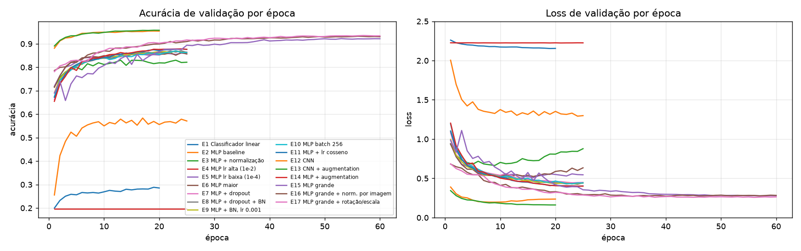

# Classificação de Dígitos no SVHN com MLP (PyTorch)

Trabalho final da disciplina de **Inteligência Artificial** (UFMS, 2026/2).

**Integrantes:** João Pedro Santos de Brito, Samyr Arruda Villanova e Valber Oliveira da Conceição

Treinamos um classificador linear, várias MLPs e, como comparação, uma CNN no dataset
[SVHN](http://ufldl.stanford.edu/housenumbers/), em 17 experimentos encadeados pela acurácia de validação. O
modelo final é uma **MLP com 93,92% de acurácia no conjunto de teste**.

## Entregáveis

| Entregável pedido no enunciado | Arquivo |
|---|---|
| Código e experimentos | [`trabalho_svhn.ipynb`](trabalho_svhn.ipynb), executado e com todas as saídas |
| Relatório em PDF | [`relatorio.pdf`](relatorio.pdf) |
| Pesos do melhor modelo | [`melhor_modelo.pt`](melhor_modelo.pt) (75 MB) |
| Predições do conjunto adicional | [`JOAOBRITO_SAMYRARRUDA_VALBERCONCEICAO_RESULTS.txt`](JOAOBRITO_SAMYRARRUDA_VALBERCONCEICAO_RESULTS.txt), 203.856 linhas |

O notebook é autossuficiente: a primeira célula grava o [`svhn_lib.py`](svhn_lib.py), que as células seguintes
importam. O arquivo `.py` está no repositório só por conveniência.

## Resultados

| Exp. | O que mudou | Validação | Teste |
|---|---|---|---|
| E1 | Classificador linear | 28,83% | 24,02% |
| E2 | MLP 2×500 da aula, entrada em [0, 1] | 58,35% | 55,01% |
| E3 | E2 + normalização por canal | 83,03% | 79,48% |
| E4 | E3 com lr 1e-2 | 19,70% | 19,59% |
| E5 | E3 com lr 1e-4 | 86,19% | 83,45% |
| E6 | E5 com rede maior (1024-512-256) | 86,23% | 83,57% |
| E7 | E6 + dropout 0,3 | 86,91% | 84,55% |
| E8 | E7 + BatchNorm | 87,02% | 84,40% |
| E9 | E8 com lr 1e-3 | 87,01% | 84,39% |
| E10 | E8 com batch 256 | 86,99% | 83,98% |
| E11 | E8 + lr com decaimento cosseno | 87,78% | 85,46% |
| E12 | CNN pequena (só comparação) | 95,45% | 95,17% |
| E13 | E12 + translação aleatória (só comparação) | 95,80% | 96,27% |
| E14 | E11 + translação aleatória de ±2 px | 87,84% | 86,21% |
| E15 | E14 com rede 4×2048, dropout 0,1, 60 épocas, lr one-cycle | 92,22% | 90,50% |
| E16 | E15 + normalização de contraste por imagem | 93,23% | 91,69% |
| **E17** | **E16 + rotação e escala (melhor MLP)** | **93,54%** | **92,39%** |
| | E17 + média sobre 25 translações na predição | 94,32% | 93,48% |
| **Final** | **E17 retreinado com todo o treino, com a média** | | **93,92%** |

Conforme orientação do professor, o modelo final precisa ser uma rede totalmente conectada, por isso a CNN (E12 e
E13) aparece apenas como comparação. A análise completa, com as curvas de loss e acurácia de cada experimento, está
no [`relatorio.pdf`](relatorio.pdf).



## Protocolo

O split `train` do `torchvision.datasets.SVHN` foi dividido em 90% para treino e 10% para validação, com semente
42. Todas as escolhas (experimento, época de parada, raio da média sobre translações) foram feitas pela validação, e
o split `test` serve apenas para relatar o desempenho. Depois de escolhida a configuração, o modelo final foi
retreinado com todo o `train`, como o enunciado permite. O conjunto adicional do professor não está neste
repositório e foi usado somente para gerar o arquivo de predições, com o modelo já definido.

## Principais conclusões

- A normalização da entrada por canal foi a mudança de maior impacto, levando a mesma MLP de 58% para 83%.
- A taxa de aprendizado do notebook da aula (1e-3) era alta demais para o problema, enquanto 1e-4 ganhou 3 pontos e
  1e-2 fez o treino colapsar.
- Com dropout e augmentation, a acurácia de treino ficou abaixo da de validação, sinal de underfitting, e aumentar a
  rede e o tempo de treino rendeu o maior salto da MLP (+4,4 pontos).
- Como a MLP não é invariante a translação, a augmentation no treino e a média das probabilidades sobre pequenos
  deslocamentos na predição compensaram parte dessa limitação.
- Mesmo assim, a CNN, com 23 vezes menos parâmetros, ficou 2,4 pontos acima da melhor MLP no teste.

## Como usar o modelo final

```python
import torch
import svhn_lib as L

ck = torch.load("melhor_modelo.pt")
modelo = L.MLP(**ck["arquitetura"])
modelo.load_state_dict(ck["state_dict"])

nomes, X = L.load_image_folder("pasta_com_as_imagens")
X = L.per_image_norm(L.preprocess(X, ck["mean"], ck["std"]))
pred = L.predict_tta(modelo, X, ck["tta_raio"])
```

## Como reproduzir

```bash
uv venv .venv
uv pip install --python .venv/bin/python torch torchvision --index-url https://download.pytorch.org/whl/cpu
uv pip install --python .venv/bin/python numpy pandas matplotlib pillow scipy pyarrow pytest jupyter nbconvert reportlab pypdfium2
.venv/bin/jupyter nbconvert --to notebook --execute --inplace --ExecutePreprocessor.timeout=-1 trabalho_svhn.ipynb
```

A execução completa leva cerca de 10 horas em CPU. Os dados do SVHN são baixados automaticamente em `data/`, e a
última seção do notebook classifica as imagens que estiverem na pasta `extra/`. Com a semente 42, rodar de novo na
mesma máquina reproduz exatamente os mesmos números.

## Estrutura do repositório

| Caminho | Conteúdo |
|---|---|
| `trabalho_svhn.ipynb` | Notebook com a implementação e os 17 experimentos |
| `svhn_lib.py` | Dados, modelos, treino, augmentation, avaliação e predição |
| `relatorio.pdf` | Relatório do trabalho |
| `melhor_modelo.pt` | Pesos da MLP final, com a arquitetura, a normalização e o raio da predição |
| `JOAOBRITO_SAMYRARRUDA_VALBERCONCEICAO_RESULTS.txt` | Predições do conjunto adicional |
| `resultados/` | Histórico, curvas e tabelas de cada experimento |
| `tests/` | Testes automatizados do `svhn_lib.py` (`pytest -q`) |
| `tools/` | Scripts que geram o notebook e o relatório e conferem os entregáveis |
